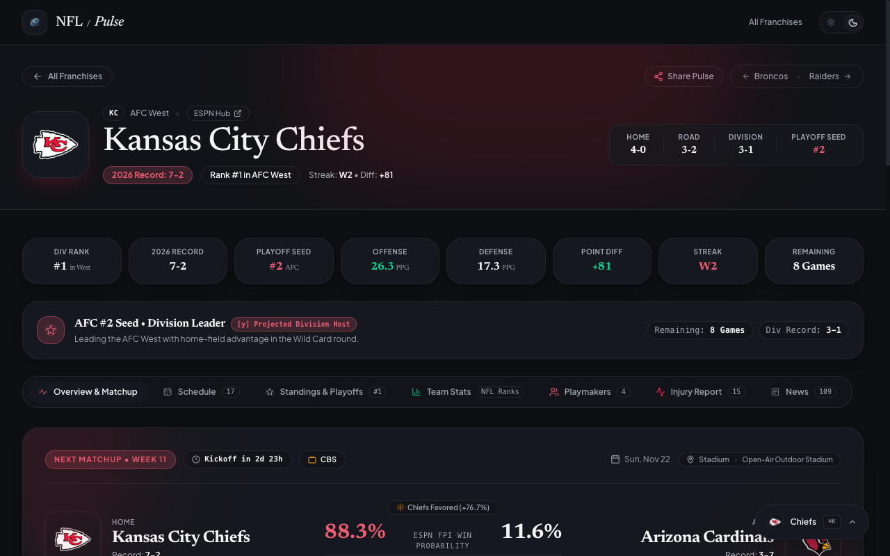

# NFL Pulse — Real-Time NFL Team Command Center

A high-performance Next.js application that lets you select any of the 32 NFL franchises and delivers their complete 18-week schedule, upcoming matchup win probabilities (computer model + betting consensus), and real-time aggregated news.



---

## ⚡ Features

1. **All 32 NFL Teams Directory**:
   - Filter by Conference (**AFC / NFC**) or Division (**East, North, South, West**).
   - Instant search by team name, city, or abbreviation (e.g. *Eagles*, *KC*, *49ers*, *Detroit*).
   - Dynamic team branding (official 500x500 logos, primary and secondary color accents).

2. **Upcoming Matchup & Win Probability Spotlight**:
   - **ESPN FPI Matchup Predictor**: Computer projected win percentages (e.g. *Chiefs 88.3% – Cardinals 11.6%*).
   - **Dual Color Visual Meter**: Split probability bar dynamically themed to each team's official hex codes.
   - **Vegas Consensus & Implied Probabilities**: Point spread, over/under total, moneyline odds, and normalized vig-free implied win percentages.
   - Stadium venue, kickoff date & time, and TV broadcast networks (CBS, FOX, NBC, ESPN, Prime Video).

3. **Complete 18-Week Schedule & Results**:
   - Filter tabs: **All Games (18)**, **Upcoming**, and **Results**.
   - Completed games show final scores with color-coded **W / L / T** badges.
   - Opponent helmets, home/away status, and stadium details.

4. **Multi-Source Real-Time News Stream**:
   - Aggregated news from **ESPN Official Editorial** and **Google News RSS** (covering local beat writers, The Athletic, NBC Sports, and wire reporting).
   - Source badges, relative publication timestamps (*"2h ago"*, *"Yesterday"*), headline snippets, and outbound links.
   - In-stream search filter to quickly find news about injuries, trades, or press conferences.

---

## 🛠️ Tech Stack & Architecture

- **Framework**: [Next.js](https://nextjs.org/) (App Router, Server Components, TypeScript)
- **Styling**: [Tailwind CSS v4](https://tailwindcss.com/)
- **Icons**: [Lucide React](https://lucide.dev/)
- **XML / RSS Parser**: `fast-xml-parser`
- **Data Sources**:
  - ESPN NFL Public REST endpoints (`teams`, `schedule`, `summary` with FPI predictor & odds)
  - Google News RSS feed for live beat-writer aggregation

---

## 🚀 Getting Started

### 1. Installation

```bash
cd nfl-pulse
pnpm install # or npm install
```

### 2. Development Mode

```bash
pnpm dev
```

Open [http://localhost:3000](http://localhost:3000) in your browser.

### 3. Production Build & Run

```bash
pnpm build
pnpm start
```

---

## 📁 Project Structure

```
nfl-pulse/
├── src/
│   ├── app/
│   │   ├── globals.css          # Dark sports theme & styles
│   │   ├── layout.tsx           # Global shell & navbar
│   │   ├── page.tsx             # Home page with 32-team directory & search
│   │   └── team/
│   │       └── [slug]/
│   │           └── page.tsx     # Dynamic team dashboard (SSG/ISR)
│   ├── components/
│   │   ├── MatchupPredictor.tsx # Win probability meter & Vegas odds
│   │   ├── Navbar.tsx           # Global navbar & quick team switcher
│   │   ├── NewsFeed.tsx         # Real-time aggregated news stream
│   │   ├── ScheduleView.tsx     # 18-week schedule & score cards
│   │   └── TeamSelector.tsx     # Filterable team cards grid
│   ├── data/
│   │   └── teams.ts             # 32 NFL teams metadata, colors & logos
│   ├── lib/
│   │   └── api.ts               # ESPN API & Google News fetchers
│   └── types/
│       └── index.ts             # TypeScript interfaces
```
